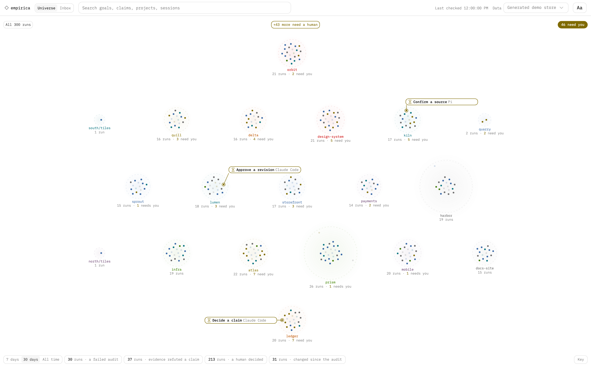

# siffran

Plugins for [Claude Code](https://docs.claude.com/en/docs/claude-code) and the [Pi coding agent](https://pi.dev): **Methodologist** for structured reasoning, and **Empirica** for evidence-backed convergence with an independent audit.

<picture>
  <source media="(prefers-color-scheme: dark)" srcset="doc/images/universe-dark.png">
  <source media="(prefers-color-scheme: light)" srcset="doc/images/universe-light.png">
  
</picture>

## Install

### Claude Code

Requires Claude Code `>=2.1.278,<2.2.0` and `python3` (see [host support](doc/hosts.md#supported-surfaces)).

```text
/plugin marketplace add obzenner/siffran
/plugin install methodologist@siffran
/plugin install empirica@siffran
```

### Pi

Requires Pi `>=1.0.0,<2.0.0` and an exact [`pi-subagents`](doc/hosts.md#pi-and-pi-subagents) version, installed first.

```sh
pi install npm:pi-subagents@0.76.1
pi install git:github.com/obzenner/siffran
```

Then restart Pi, or run `/reload` in an existing session.

Empirica 6 does not load `empirica.run/2`; start a fresh run/3 generation. Qualified deterministic
spikes use an exact operator-qualified local Docker binding with no ambient host-shell fallback. See the
[Empirica 6 upgrade guide](doc/upgrading-empirica-6.md).

## Usage

- `/empirica <goal>` starts an Empirica run. You approve its budgets before it investigates; `/empirica --auto <goal>` accepts them within fixed bounds ([governance](plugins/empirica/skills/empirica/references/governance.md)).
- `/think <intent>` runs a Methodologist reasoning workflow.
- The read-only observer shows your runs: `/empirica:ui` on Claude Code, `/empirica-ui` on Pi, or `make ui` from a checkout.

See the [Empirica skill](plugins/empirica/skills/empirica/SKILL.md) for how a run works.

## Plugins

<!-- BEGIN GENERATED: plugins (managed by the checkup skill — do not edit by hand) -->
| Plugin | Version | Description |
|--------|---------|-------------|
| `methodologist` | 0.10.1 | Formal reasoning catalog — lets users choose and execute evidence-backed CS/math methodologies with traced phases and structured output. |
| `empirica` | 6.0.0 | Host-neutral empirical-convergence workflow — requires exact run-configuration approval (or provenance-bound auto), cited research before spikes, per-artifact producer attribution, and a current distinct host-observed audit. Unknown or mixed identity evidence fails closed. |
<!-- END GENERATED: plugins -->

## Documentation

- [Empirica skill](plugins/empirica/skills/empirica/SKILL.md), with its [governance](plugins/empirica/skills/empirica/references/governance.md) and [audit](plugins/empirica/skills/empirica/references/audit.md) references
- [Host support and versions](doc/hosts.md)
- [Upgrading to Empirica 6](doc/upgrading-empirica-6.md)
- [Observer UI](plugins/empirica/ui/README.md)
- [Architecture decisions](doc/adr/)
- [Testing](doc/testing.md)

## Development

Run `make help` to list every operation, and `make check` before committing.
See [CLAUDE.md](CLAUDE.md) for the repo structure and conventions.

## Licence

Licensed under the [PolyForm Internal Use License 1.0.0](./LICENSE). You are free to install and use this, including inside a company, and to change it for your own use. You may not redistribute or resell it. The full terms are in [`LICENSE`](./LICENSE). Third-party parts keep their own licences, in the `LICENSE` files beside them (`plugins/empirica/ui/vendor/`, `plugins/empirica/ui/dist/`).
